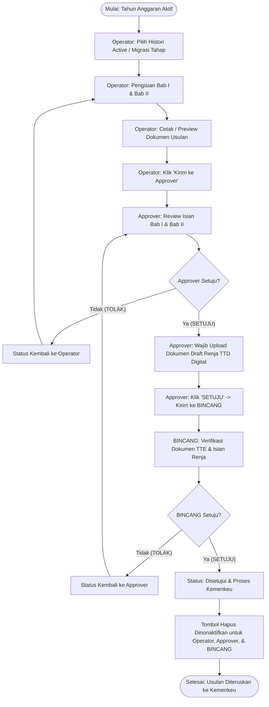

# Dokumen Alur Proses Bisnis & Hak Akses Role
## Menu Rencana Kerja (Renja) Eselon I — PPATK

Dokumen ini menjelaskan alur proses bisnis end-to-end, keterkaitan antar submenu, serta rincian hak akses dan kewajiban masing-masing **Role User** pada modul **Renja Eselon I** aplikasi Perencanaan Kerja (Pro-Renja) PPATK.

---

## 1. Ringkasan Submenu Renja Eselon I

Modul Renja Eselon I terdiri dari 4 (empat) submenu utama yang saling terintegrasi:

| No | Submenu | Path Route | Deskripsi & Fungsi Utama |
|---|---|---|---|
| 1 | **Pilih Histori** | `/eselon1/pilih-histori` | Memilih tahapan status histori aktif (Pagu Indikatif `D00`/`D0a-D0z`, Pagu Anggaran `D01-D99`, Alokasi Anggaran `E00-E99`), melakukan migrasi data antar tahapan, dan mengelola versi revisi. |
| 2 | **Isian Bab I** | `/eselon1/bab-1` | Menginput narasi dan tabel data Bab I (Gambaran Umum, Capaian Kinerja T-1 & T-2, Arah Kebijakan & Target T+1, serta Analisis Situasi Momentum/Tantangan). |
| 3 | **Isian Bab II** | `/eselon1/bab-2` | Menginput narasi dan tabel data Bab II (Pengantar Program Kerja, Rincian Paket Program Kerja Lintas Unit Kerja, dan Rincian Paket Program Kerja Unit Kerja). |
| 4 | **Monitoring Submit & Approve Data** | `/eselon1/monitoring` | Pemantauan status histori pengajuan, pengunggahan dokumen TTE, alur persetujuan (*approval workflow*) bertingkat, serta pencetakan dokumen resmi Bab I & Bab II. |

---

## 2. Rincian Peran & Hak Akses Role User

Terdapat 4 (empat) Role User yang terlibat dalam proses bisnis Renja Eselon I:

### 👤 A. Role OPERATOR (Unit Kerja / Deputi)
* **Tugas Utama**: Mengisi seluruh data usulan perencanaan kerja dan mengirimkan pengajuan ke Approver.
* **Hak Akses & Kewajiban**:
  1. **Menu Pilih Histori**: Bebas memilih tahapan histori aktif dan melakukan migrasi versi revisi baru.
  2. **Menu Isian Bab I & Bab II**: Mengisi, mengubah, dan menyimpan seluruh narasi RichText, data indikator kinerja (IKP/Sasaran Program), serta paket program kerja (Lintas Unit & Unit Kerja).
  3. **Menu Monitoring**:
     - **Kirim Data**: Berhak mengirimkan usulan data histori ke **Approver** (`Kirim ke Approver`).
     - **Cetak Dokumen**: Berhak mencetak/preview hasil input dokumen Bab I & Bab II.
     - **Upload Dokumen TTE**: ❌ **Tidak Memiliki Kewajiban/Akses Upload TTE** (Fasilitas upload TTE khusus untuk role Approver).
     - **Unduh Dokumen TTE**: 🟢 **Dapat Mengunduh Ulang (*Download*)** dokumen TTE yang telah diunggah oleh Approver.
     - **Hapus Data**: ❌ **Tidak Dapat Menghapus Data Histori** (Tombol hapus selalu non-aktif untuk Operator).

---

### 🛡️ B. Role APPROVER (Atasan Unit Kerja / Kasubbag / Kabag / Deputi)
* **Tugas Utama**: Memeriksa kualitas data usulan, mengunggah dokumen yang telah ditandatangani secara elektronik (TTE), serta menyetujui pengajuan ke BINCANG.
* **Hak Akses & Kewajiban**:
  1. **Pemeriksaan Data**: Memeriksa hasil isian Bab I & Bab II yang dikirimkan oleh Operator Unit Kerja.
  2. **Pengunggahan Dokumen TTE (Wajib)**: ⚠️ **WAJIB Mengunggah Dokumen Draft Renja Eselon I TTD Digital** (`Upload TTD *`) pada kolom AKSI sebelum dapat menyetujui pengajuan.
  3. **Aksi Persetujuan (Approval Workflow)**:
     - 🟢 **SETUJU**: Mengirimkan data usulan ke pihak **BINCANG** (Persyaratan dokumen TTE wajib sudah diunggah).
     - 🔴 **TOLAK**: Mengembalikan data usulan ke **Operator** untuk dilakukan perbaikan/revisi.
  4. **Penghapusan Data**:
     - 🟢 **Bisa Hapus**: Dapat menghapus data histori selama status **Belum Disetujui** (`is_approved = false`).
     - ❌ **Dilarang Hapus**: Tombol hapus **dinonaktifkan** apabila status data sudah **"Disetujui & Proses Kemenkeu"**.

---

### 🏛️ C. Role BINCANG (Biro Perencanaan dan Keuangan)
* **Tugas Utama**: Melakukan verifikasi akhir terhadap seluruh usulan Renja Eselon I dari seluruh Unit Kerja PPATK dan memproses ke Kementerian Keuangan.
* **Hak Akses & Kewajiban**:
  1. **Verifikasi Nasional**: Memantau dan memeriksa pengajuan usulan dari seluruh Deputi / Unit Kerja.
  2. **Verifikasi Dokumen TTE**: Memeriksa keberadaan dan keabsahan dokumen TTE yang telah diunggah oleh Approver Unit Kerja.
  3. **Unduh Dokumen TTE**: 🟢 **Dapat Mengunduh Ulang (*Download*)** dokumen TTE yang telah diunggah oleh Approver.
  4. **Upload Dokumen TTE**: ❌ **Tidak Memiliki Akses Upload TTE** (Dokumen disuplai dari Approver).
  5. **Persetujuan Akhir (Final Approval)**:
     - 🟢 **SETUJU**: Mengubah status pengajuan menjadi **"Disetujui & Proses Kemenkeu"** (`is_approved = true`).
     - 🔴 **TOLAK**: Mengembalikan data usulan ke pihak **Approver** untuk diperbaiki.
  6. **Penghapusan Data**:
     - 🟢 **Bisa Hapus**: Dapat menghapus data histori selama status **Belum Disetujui** (`is_approved = false`).
     - ❌ **Dilarang Hapus**: Tombol hapus **dinonaktifkan** apabila status data sudah **"Disetujui & Proses Kemenkeu"**.

---

### 🔑 D. Role SUPER ADMIN
* **Tugas Utama**: Mengawasi seluruh jalannya sistem, simulasi antar role (*Role Switcher*), dan penanganan kasus khusus.
* **Hak Akses & Kewajiban**:
  1. Memiliki **Akses Penuh** ke seluruh submenu (Pilih Histori, Bab I, Bab II, dan Monitoring).
  2. Dapat melakukan simulasi pengujian sebagai Operator, Approver, maupun BINCANG.
  3. Memiliki wewenang override untuk mengunggah dokumen TTE atau mengelola histori data apabila diperlukan.

---

## 3. Matriks Hak Akses & Fitur (Access Control Matrix)

| Fitur / Aksi | Operator | Approver | BINCANG | Super Admin |
|---|:---:|:---:|:---:|:---:|
| Pilih & Migrasi Histori | ✅ Ya | ✅ Ya | ✅ Ya | ✅ Ya |
| Edit Isian Bab I & Bab II | ✅ Ya | 👁️ Lihat | 👁️ Lihat | ✅ Ya |
| Cetak / Preview Dokumen Bab I & II | ✅ Ya | ✅ Ya | ✅ Ya | ✅ Ya |
| **Kirim Data ke Approver** | ✅ Ya | ➖ N/A | ➖ N/A | ✅ Ya |
| **Upload Dokumen TTE Digital** | ❌ Tidak | ✅ **Wajib** | ❌ Tidak | ✅ Ya |
| **Unduh Dokumen TTE Digital** | ✅ Ya | ✅ Ya | ✅ Ya | ✅ Ya |
| **Setuju / Kirim ke BINCANG** | ❌ Tidak | ✅ Ya | ➖ N/A | ✅ Ya |
| **Setuju (Proses Kemenkeu)** | ❌ Tidak | ➖ N/A | ✅ Ya | ✅ Ya |
| **Tolak Pengajuan** | ❌ Tidak | ✅ Ke Operator | ✅ Ke Approver | ✅ Ya |
| **Hapus Data (Belum Disetujui)** | ❌ Tidak | ✅ Ya | ✅ Ya | ✅ Ya |
| **Hapus Data (Disetujui & Proses Kemenkeu)** | 🔒 **Disabled** | 🔒 **Disabled** | 🔒 **Disabled** | ✅ Ya |

---

## 4. Diagram Alur Proses Bisnis (Business Process Flowchart)

---

## 5. Alur Keterkaitan Data & Status Revisi

1. **Pagu Indikatif (`D00`)**:
   - Merupakan baseline histori awal. `D00` terkunci dan tidak dapat diubah kodenya.
   - Jika ada penolakan dari Approver/BINCANG pada tahap Pagu Indikatif, sistem secara otomatis menambahkan varian revisi baru (`D0a`, `D0b`, `D0c`, dst.).
2. **Pagu Anggaran (`D01` - `D99`)**:
   - Dibuat melalui tombol **Migrasi Histori** dari tahapan Pagu Indikatif (`D00`).
   - Melanjutkan pengisian narasi Bab I dan Bab II dengan penyesuaian angka Pagu Anggaran terbaru.
3. **Alokasi Anggaran (`E00` - `E99`)**:
   - Dibuat melalui migrasi dari tahapan Pagu Anggaran (`D01`).
   - Merupakan tahap penguncian alokasi akhir sebelum ditetapkan secara definitif.
4. **Proteksi Penghapusan Data**:
   - Data histori yang telah mencapai status **"Disetujui & Proses Kemenkeu"** dikunci dari aksi penghapusan untuk menjaga integritas jejak audit (*audit trail*) dan konsistensi data laporan ke Kemenkeu.

---

*Dokumen ini dibuat secara otomatis sebagai panduan standar operasional sistem Pro-Renja Eselon I PPATK.*

